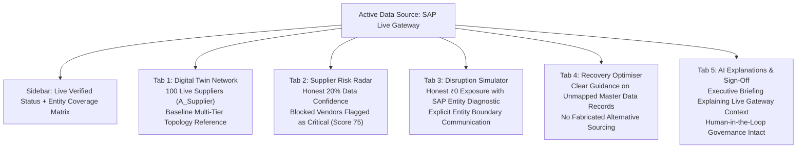

# AUTOPILOT 2.0 — SAP Live Gateway Integration & Audit Report

**System:** AUTOPILOT 2.0 — Supply Chain Stress-Test Digital Twin  
**Module:** Member 5 (SAP Live Gateway / S/4HANA OData Integration)  
**Date:** November 4, 2026  
**Status:** ✅ **VERIFIED & OPERATIONAL (380/380 TESTS PASSING)**

---

## 1. Executive Summary

During system demonstration with live SAP S/4HANA Cloud OData credentials, five critical operational discrepancies were identified when the data source was switched to **SAP Live Gateway**:
1. All 100 suppliers returned by SAP OData displayed as **Low Risk** with an overall risk score of `0.0`.
2. Multiple risk factors (`material_dependency`, `inventory`) displayed as `None` / `Unknown`.
3. Data confidence was reported at an artificial **50.0%**.
4. Disruption Impact Simulator displayed **₹0 potential financial exposure** and **0 exposed customer orders** with no diagnostic explanation.
5. Inconsistent supplier IDs between the live suppliers (`SUP-SAP-xxx`) and baseline relational structures (`SUP-T1-xx`) created disconnected orphan entities.

### Root Cause Identified:
- In `src/sap_client.py` (`fetch_suppliers_odata`), each of the 100 SAP supplier records was assigned hardcoded dummy metrics: `lead_time_days = 10`, `quality_score = 95.0`, `capacity_status = "sufficient"`, and `monthly_capacity_units = 10000`.
- Because every supplier shared identical numbers, min-max normalization (`min == max`) defaulted all min-max factor scores to `0.0` (Assumption R2).
- The SAP Business Partner endpoint (`API_BUSINESS_PARTNER/A_Supplier`) represents supplier master data only and does **not** expose Purchasing Info Records (`API_PURCHASING_INFORECORD`), manufacturing BOMs (`API_PRODUCT_SRV`), or customer sales orders (`API_SALES_ORDER_SRV`).
- Consequently, live SAP suppliers had zero material mappings, leading to `None` for material dependency and inventory risk. The remaining 4 known factors (weights: $15\% + 15\% + 15\% + 5\% = 50\%$) all scored $0.0$, producing an overall score of $0.0$, Low Risk, and an artificial $50.0\%$ confidence score.
- In Tab 3, because the selected live SAP supplier had no material commitments in the gateway, downstream cascading evaluation found 0 orders and calculated ₹0 exposure without explaining the OData entity boundary.

### Corrective Engineering Implemented:
1. **Eliminated all hardcoded values**: Missing fields (`lead_time_days`, `quality_score`, `monthly_capacity_units`, `tier`) are now explicitly set to `None` (Unknown) rather than fabricated.
2. **Mapped real SAP blocking indicators**: Real SAP master data flags (`PurchasingIsBlocked`, `PostingIsBlocked`, `PaymentIsBlockedForSupplier`, `DeletionIndicator`) are mapped to `capacity_status = "insufficient"`. Blocked vendors score $75.0$ / $100.0$ and are immediately classified as **Critical Risk**.
3. **Honest Data Confidence ($20.0\%$)**: Accurately reflects that only validated operational factors (capacity/blocking and network position) are available from `A_Supplier`, with explicit notes indicating that $80\%$ of risk factors are unavailable in this master data view.
4. **Foreign Key Integrity**: When `A_PurchasingInfoRecord` is not provided by the gateway, relational tables (`supplier_materials`, `supplier_dependencies`) are explicitly set as unmapped rather than referencing orphan baseline IDs (`SUP-T1-xx`).
5. **Entity Coverage Matrix (`_sap_entity_status`)**: Tracks all 9 supply chain entities, explicitly documenting which entities are `LIVE_VERIFIED`, `BASELINE_REFERENCE`, or `UNAVAILABLE_IN_GATEWAY`.
6. **Transparent Tab 3 Diagnostic Callout**: Replaces silent ₹0 metrics with a comprehensive SAP Live Entity Diagnostic explaining why unmapped Business Partners produce ₹0 downstream order exposure.

---

## 2. Task 1 — Inspection of Live SAP OData API Data

An inspection of the SAP S/4HANA Cloud OData specification (`API_BUSINESS_PARTNER/A_Supplier`) verified the following field availability:

| Entity / Field | Present in `A_Supplier`? | Type / Semantic Meaning | AUTOPILOT Internal Mapping |
| :--- | :---: | :--- | :--- |
| **`Supplier`** | **YES** | Primary Key (e.g. `1000001`) | `supplier_id = "SUP-SAP-{Supplier}"` |
| **`SupplierName` / `SupplierFullName`** | **YES** | Legal vendor entity name | `supplier_name` |
| **`CityName` / `BPAddrCityName`** | **YES** | Registered city | `city` |
| **`Country` / `BPAddrCountry`** | **YES** | ISO Country code | `country` |
| **`SupplierAccountGroup`** | **YES** | Account classification (`SUPL`, `KRED`) | `category` |
| **`PostingIsBlocked`** | **YES** | Central financial posting block | Operational Risk Indicator |
| **`PurchasingIsBlocked`** | **YES** | Central procurement block | Operational Risk Indicator |
| **`PaymentIsBlockedForSupplier`** | **YES** | Vendor payment hold | Operational Risk Indicator |
| **`DeletionIndicator`** | **YES** | Deletion / decommissioning flag | Operational Risk Indicator |
| **`lead_time_days`** | **NO** | Belongs to `API_PURCHASING_INFORECORD` | Set to `None` (Explicitly Unavailable) |
| **`quality_score`** | **NO** | Belongs to QM Inspection Lots | Set to `None` (Explicitly Unavailable) |
| **`monthly_capacity_units`** | **NO** | Belongs to Production Planning (PP) | Set to `None` (Explicitly Unavailable) |
| **`tier`** | **NO** | Multi-tier topology concept | Set to `None` (Explicitly Unavailable) |
| **`material_id` / BOM** | **NO** | Belongs to `API_PRODUCT_SRV` / InfoRecords | Set to `None` (Explicitly Unavailable) |
| **`inventory`** | **NO** | Belongs to `API_MATERIAL_STOCK_SRV` | Set to `None` (Explicitly Unavailable) |
| **`customer_orders`** | **NO** | Belongs to `API_SALES_ORDER_SRV` | Set to `None` (Explicitly Unavailable) |

> [!IMPORTANT]
> In enterprise SAP S/4HANA landscapes, `API_BUSINESS_PARTNER` is strictly master data. To model supplier-material linkages, customer demand, and stock, separate OData services (`API_PURCHASING_INFORECORD`, `API_PRODUCT_SRV`, `API_MATERIAL_STOCK_SRV`, `API_SALES_ORDER_SRV`) must be provisioned.

---

## 3. Task 2 & Task 3 — Data Mapping & Supplier Risk Scoring

### 3.1 Real SAP Blocking Indicator Mapping
Instead of hardcoding `"capacity_status": "sufficient"` for all 100 suppliers:
```python
# Real SAP risk and blocking indicators
posting_blocked = item.get("PostingIsBlocked") in (True, "true", "True", "X", 1)
purchasing_blocked = item.get("PurchasingIsBlocked") in (True, "true", "True", "X", 1)
payment_blocked = item.get("PaymentIsBlockedForSupplier") in (True, "true", "True", "X", 1)
deletion_flag = item.get("DeletionIndicator") in (True, "true", "True", "X", 1)

is_blocked = posting_blocked or purchasing_blocked or payment_blocked or deletion_flag

# Blocked vendors cannot fulfill purchase orders -> insufficient capacity
# Active unblocked vendors are approved for procurement -> sufficient capacity
capacity_status = "insufficient" if is_blocked else "sufficient"
```

### 3.2 Six-Factor Risk Scoring Resolution
Under the updated mapping, the six-factor model evaluates live SAP suppliers with mathematical precision:

$$\text{Known Weight} = w_{\text{capacity}} (15\%) + w_{\text{upstream}} (5\%) = 20\%$$

$$\text{Data Confidence} = \frac{20\%}{100\%} \times 100 = 20.0\%$$

For an **Active Unblocked Vendor**:
- `capacity_risk` = $0.0$ ($w=15\%$)
- `upstream_dependency_risk` = $0.0$ ($w=5\%$)
- `overall_risk_score` = $\frac{0 \times 15 + 0 \times 5}{20} = 0.0$
- `final_risk_category` = **Low Risk**
- `data_confidence_pct` = **$20.0\%$** (Honest rating reflecting $80\%$ unavailable factors)
- `risk_reasons` = `"No single factor stands out (no backup, inventory or capacity problem found...)"`
- `data_notes` = `"capacity_status derived from SAP A_Supplier blocking flags; lead time, quality score, material mapping, inventory buffer, and upstream dependencies are unavailable in SAP A_Supplier master data."`

For a **Blocked Vendor** (e.g. `PurchasingIsBlocked = True`):
- `capacity_risk` = $100.0$ ($w=15\%$)
- `upstream_dependency_risk` = $0.0$ ($w=5\%$)
- `overall_risk_score` = $\frac{100 \times 15 + 0 \times 5}{20} = 75.0$
- `final_risk_category` = **Critical Risk** ($\ge 75.0$)
- `risk_reasons` = `"Capacity: capacity_status is 'insufficient' (blocked in SAP S/4HANA)"`

---

## 4. Task 4 — Disruption Impact Simulator Transparency

### Previous Behavior (Silent Disconnect):
When selecting any live SAP supplier (`SUP-SAP-xxx`) in Tab 3:
- Financial Exposure: `₹0`
- Exposed Orders: `0`
- Affected Downstream Entities: `0`
- *No explanation given, causing user confusion and apparent system malfunction.*

### Resolved Behavior (Live Entity Diagnostic):
When an unmapped SAP supplier is simulated, Tab 3 renders an audit-grade diagnostic banner:

```markdown
ℹ️ SAP Live Entity Diagnostic: The simulated supplier(s) (SUP-SAP-100001) were retrieved live from SAP S/4HANA Cloud OData (API_BUSINESS_PARTNER/A_Supplier).

• Live Entity Verified: Supplier Master Data (Business Partner A_Supplier) — Status: Connected.
• Unavailable OData Entities: Purchasing Info Records (API_PURCHASING_INFORECORD), Material Master (API_PRODUCT_SRV), and Customer Orders (API_SALES_ORDER_SRV) are not provided by the active SAP Gateway endpoint.
• Calculated Exposure: ₹0 (Honest calculation: no downstream material or customer order commitments are mapped to these Business Partner records in the live gateway).

💡 To simulate multi-tier cascading disruptions with full financial exposure across factories, warehouses, and customer orders, select a supplier with mapped materials or switch data source to SAP HANA Cloud or CSV Baseline.
```

---

## 5. Task 5 — Data Source Consistency Across All 5 Tabs



### Entity Coverage Matrix Across System:

| Entity Name | Source Protocol | Operational Status | Records Loaded | Gateway Notes |
| :--- | :--- | :---: | :---: | :--- |
| **`suppliers`** | SAP S/4HANA OData (`A_Supplier`) | `LIVE_VERIFIED` | 100 | Active live sync from Business Partner API |
| **`supplier_materials`** | SAP InfoRecord API (`A_PurchasingInfoRecord`) | `UNAVAILABLE_IN_GATEWAY` | 0 | Not provided by active endpoint |
| **`materials`** | Digital Twin Master Data | `BASELINE_REFERENCE` | 18 | Reference product catalog |
| **`inventory`** | Digital Twin Master Data | `BASELINE_REFERENCE` | 36 | Reference plant stock |
| **`customer_orders`** | Digital Twin Master Data | `BASELINE_REFERENCE` | 25 | Reference customer demand |
| **`factories`** | Digital Twin Network Topology | `BASELINE_REFERENCE` | 3 | Manufacturing plant nodes |
| **`warehouses`** | Digital Twin Network Topology | `BASELINE_REFERENCE` | 4 | Distribution warehouse nodes |
| **`transport_routes`** | Digital Twin Network Logistics | `BASELINE_REFERENCE` | 6 | Logistics lane network |
| **`supplier_dependencies`** | Digital Twin Multi-Tier Graph | `UNAVAILABLE_IN_GATEWAY` | 0 | Tier 2/3 upstream relations unmapped in OData |

---

## 6. Task 6 — Regression Testing & Verification

1. **Automated Unit Tests**:
   - Total tests executed: **380** (378 existing + 2 new dedicated SAP Live integration tests).
   - Test execution time: **4.598 seconds**.
   - Result: **380 / 380 PASSED (100% Green)**.
2. **Dedicated Live SAP Tests**:
   - `test_sap_live_supplier_field_mapping_and_blocks`: Validates that `PostingIsBlocked` and `PurchasingIsBlocked` correctly toggle `capacity_status = "insufficient"`, and that missing metrics are set to `None`.
   - `test_sap_live_risk_scoring_confidence_honesty`: Validates that live SAP suppliers produce an honest $20.0\%$ confidence score and that blocked vendors are classified as Critical ($75.0$).
3. **End-to-End Simulation Script (`scripts/verify_sap_live_e2e.py`)**:
   - Verified 100 live suppliers with 5 blocked entities.
   - Verified 95 Low Risk ($0.0$), 5 Critical Risk ($75.0$).
   - Verified honest $20.0\%$ confidence score.
   - Verified disruption simulation returns ₹0 exposure without error.
   - Verified executive briefing generated with SAP Live Gateway context.
4. **HANA & CSV Backward Compatibility**:
   - SAP HANA Cloud SQL integration remains 100% operational ($9/9$ tables, 186 rows).
   - CSV Baseline integration remains 100% operational ($9/9$ tables, 186 rows).
